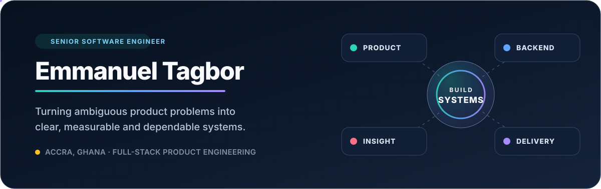

  

  
  
  

I build dependable software across product interfaces, backend services,
integrations and delivery systems. I’m most useful when an ambiguous problem
needs to become clear architecture, measurable learning and production-ready
software.

<table>
  <tr>
    <td width="50%" valign="top">
      <h3>01 · Product systems</h3>
      
Architecture, interfaces, content platforms and design systems that stay coherent as products evolve.

      TypeScript · React · Next.js · Gatsby · Storybook · Contentful · Cloudinary
    </td>
    <td width="50%" valign="top">
      <h3>02 · Services & integrations</h3>
      
APIs, payments, data workflows and custom platform tooling across product boundaries.

      Node.js · Express · GraphQL · REST · PostgreSQL · Supabase · Stripe · Paystack
    </td>
  </tr>
  <tr>
    <td width="50%" valign="top">
      <h3>03 · Experimentation & insight</h3>
      
Experiments, analytics and feedback loops that turn user behaviour into better product decisions.

      Optimizely · GA4 · GTM · Medallia · Typeform
    </td>
    <td width="50%" valign="top">
      <h3>04 · Reliability & delivery</h3>
      
Accessibility, performance, security, observability and release practices built into delivery.

      Crownpeak · Datadog · GitHub Actions · Vercel · Rust
    </td>
  </tr>
</table>

  Based in Accra, Ghana · Working across teams, disciplines and time zones

